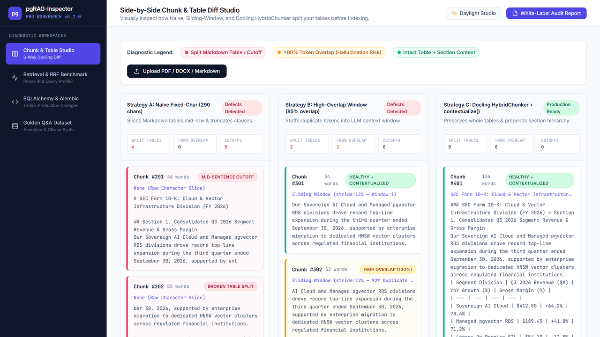
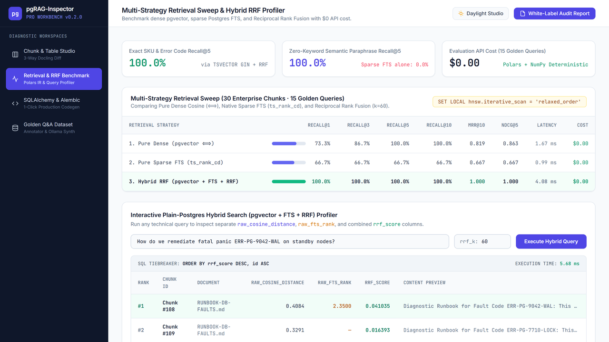
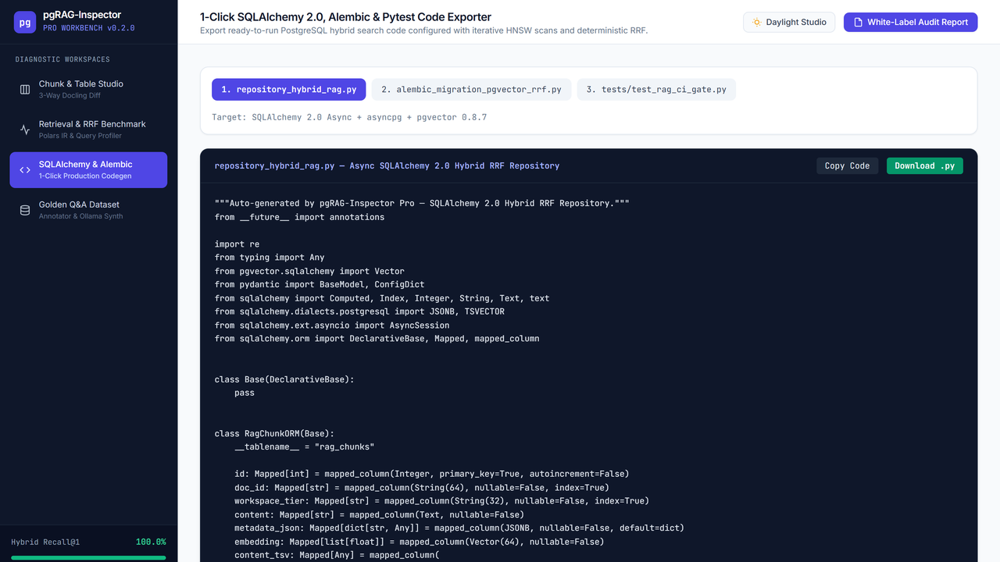

# pgRAG-Inspector: Local-First PostgreSQL 17 (pgvector + FTS) Hybrid RRF & Table Chunk Workbench

**Stop paying + in OpenAI LLM-as-a-judge API bills just to test RAG chunking and pgvector retrieval.**

### 👉 [Download Free Lite CLI () or pgRAG-Inspector Pro Studio on Gumroad](https://mtalha5.gumroad.com/l/pgrag-inspector)

- **Download Releases ( Free Lite CLI ZIP & Pro Visual Workbench):** https://mtalha5.gumroad.com/l/pgrag-inspector
- **Full Technical Benchmark Write-Up (Dev.to):** https://dev.to/mtalha5/what-broke-when-i-tested-pgvector-vs-postgres-full-text-search-vs-hybrid-rrf-on-30-tricky-rag-4f8l

---

## 1. Visual 3-Column Chunk & Markdown Table Diff Studio (/diff)
Default character and sliding-window splitters silently chop Markdown and PDF financial tables mid-row and generate >80% duplicate token overlap. **pgRAG-Inspector** visually diffs Naive Fixed-Char vs. Sliding Window vs. Docling HybridChunker side by side before you index:

---

## 2. Zero-Token Polars/NumPy IR Sweep & Hybrid RRF Profiler (/benchmark)
Evaluated across 30 enterprise chunks (SEC 10-K financial tables, cloud DB pricing matrices, fault runbooks, and SKUs) and 15 Golden Queries in **1.99 ms** with **.00 API cost**:

| Retrieval Strategy | Recall@1 | Recall@3 | Recall@5 | MRR@10 | NDCG@5 | Mean Latency | API Cost |
| :--- | :---: | :---: | :---: | :---: | :---: | :---: | :---: |
| **1. Pure Dense (pgvector <=>)** | 73.3% | 86.7% | 100.0% | 0.819 | 0.863 | 1.23 ms | $0.00 |
| **2. Pure Sparse (	s_rank_cd)** | 66.7% | 66.7% | 66.7% | 0.667 | 0.667 | 0.74 ms | $0.00 |
| **3. Hybrid RRF (k=60, id ASC)** | **100.0%** | **100.0%** | **100.0%** | **1.000** | **1.000** | **1.99 ms** | **$0.00** |

---

## 3. 1-Click Async SQLAlchemy 2.0, Alembic & Pytest CI Exporter (/codegen)
Exports production-ready PostgreSQL 17 Hybrid RRF code with inner-window deterministic tie-breaking (ORDER BY score DESC, id ASC) and HNSW iterative scanning (SET LOCAL hnsw.iterative_scan = 'relaxed_order'):

---

## 📦 Download & Installation

Both the ** Free Lite CLI + 30-Chunk Benchmark Dataset** (pgrag-eval-lite-v0.2.0.zip) and the full **4-Page FastAPI + HTMX Visual Workbench** (pgRAG-Inspector-Pro-v0.2.0.zip) are hosted on Gumroad:

### 👉 [Get the Free Lite CLI () or Pro Visual Workbench Here](https://mtalha5.gumroad.com/l/pgrag-inspector)
